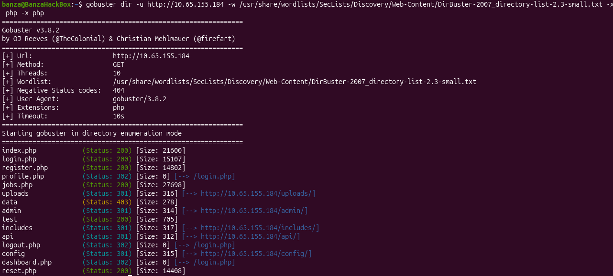
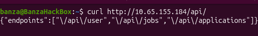
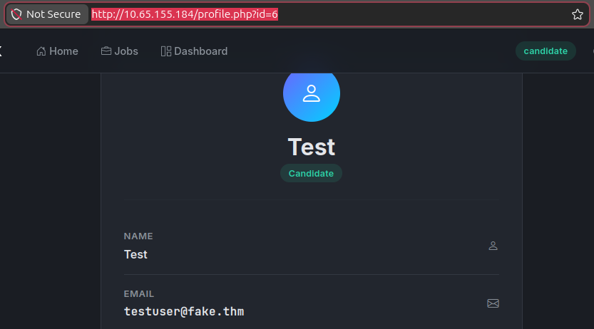
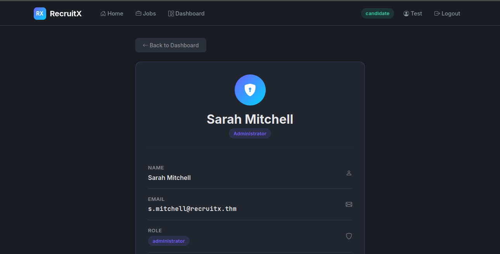
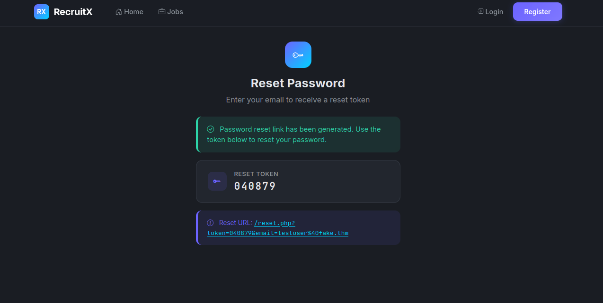

this report wull be sctructured in sections 

1 summary o pentest 
2 and subsections walktrough process 
3 vulnerabilites classification
4 impacts to bussines, clients an legal inpications 
5  mitigation plan 

#1 This report documents the security assessment and full compromise of the target machine (`10.65.155.184`). The compromise was achieved through a multi-stage attack chain involving initial reconnaissance, broken object-level access control (IDOR), insecure password reset implementation, administrative portal access, and remote code execution (RCE) via an incomplete file upload extension blocklist.

#2 
the test started with Reconnaissance & Enumeration 

##Nmap 

22, 80, 3006, 8080 open. 

NOTE!22 is good for SSh in case credentials can be aquired

NOTE!3006 indicates SQL that could be an possible exploit for injection

with curl the following result was obtain 

curl -I http://10.65.155.184
HTTP/1.1 200 OK
Date: Tue, 11 Aug 2026 12:46:11 GMT
Server: Apache/2.4.58 (Ubuntu)
Set-Cookie: PHPSESSID=9bdnlbtc6sanlrnf12k3v4mt7h; path=/
Expires: Thu, 19 Nov 1981 08:52:00 GMT
Cache-Control: no-store, no-cache, must-revalidate
Pragma: no-cache
Content-Type: text/html; charset=UTF-8
(format inside md to resamble bash terminal)

`Server: Apache 2.4.58 `
the server header confirms that using Apache 

with that is possible no only to confirm on vulnerability database if exist any know to 2.4.58 version but also confirm the classic LAMP(Linux, Apache, MySql, Php) setup 
 
 then i proceed to gobuster to enum directories 

while test manually the application, to unsdertand behaviors. 

the go buster yeilds the following result 

as soon i look it, notice some interesting php classes that woth keep in mind to explore later 
`/reset.php`,`profile.php`

also in parelel 

done an curl http://IP/api 

Api lists itself endpoints 

NOTE! Information that an user should not be able to access on production enviroments. 

then i proceed to creat an user so that i could have access to authenticate area. 

as soon as i logged i proceed to profile since i remeber that `profile.php` was listed in intent to explore around

looking on profile link  i supected that `?id=6` could be an `IDOR` 

to proof my theory i tested change the id for another

i was able to access another user profile, confirming the IDOR CVE 

on of those beeing an `ADMIN` profile. 

resulting valuable intel `s.mitchell@recruitx.thm` that could be used later. 

the id was 1 ** usualy lower IDs belong to adminitrator, stakeholders and or VIP`s. ** 

after exploring and fuzing a bit more in others accesblie directories nothing was found. 

at this point i dicided to go back to `reset.php` the password recovery flux and look for any possible exploits

testing the flux i disvoery that handles link an mfa token in the same page. 

