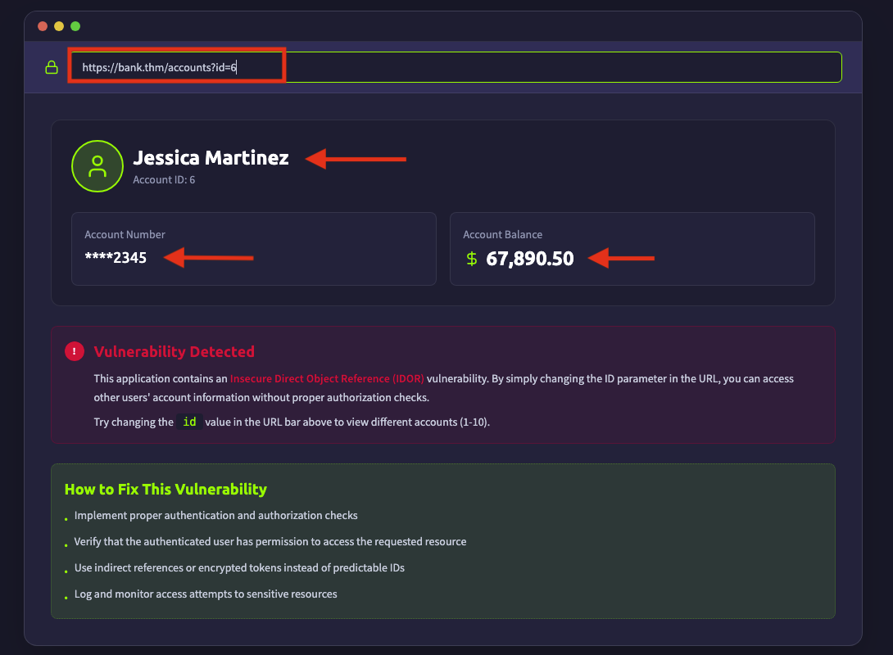

# Broken Access Control 

Broken Access Control happens when the server doesn’t properly enforce **who can access what** on every resource.

One of the most common occurrences is IDOR (Insecure Direct Object Reference).

In this room's case, on the URL `https://bank.thm/accounts?id=5`, the IDOR is in the parameter `?id=5`.

With that in mind, we could search through multiple users by changing the ID from `5` to `6`:

This gave us access to sensitive information, such as the account owner, balance, and even a partial account number.

Not only do we leverage horizontal escalation, but we also breach Confidentiality (from the CIA Triad) and governmental data protection laws, such as Brazil's **LGPD** (*Lei Geral de Proteção de Dados*), Europe's **GDPR** (*General Data Protection Regulation*), and California's **CCPA** (*California Consumer Privacy Act*).

It is safe to assume that neither you nor anyone else wants personal sensitive data being exposed, especially to bad actors.

This issue could be solved by simply enforcing session controls so that after authentication, a user only has access to their own information.

Many other solutions are available and should be applied as well.