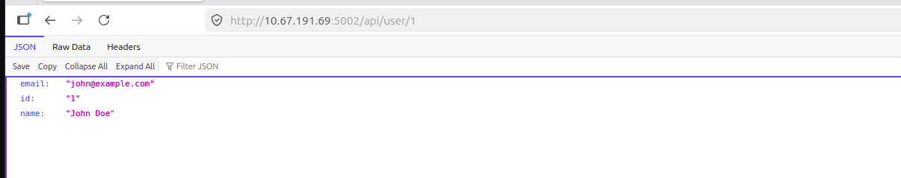
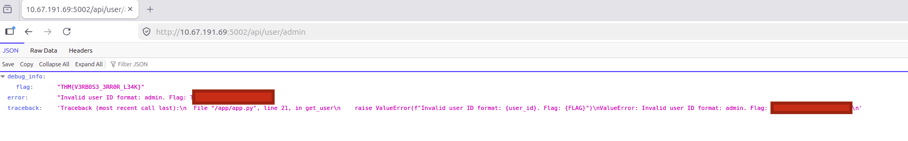

# Security misconfiguration

What It Is
Security misconfigurations happen when systems, servers, or applications are deployed with unsafe defaults, incomplete settings, or exposed services. These are not code bugs, but mistakes in how the environment, software, or network is set up. They create easy entry points for attackers.

The TryHackMe room mentions an AWS S3 bucket leak from Uber in 2017 due to a misconfigured policy that allowed anyone to read the data. 

Then it leaves us with this question: "It appears that the developers left too many traces in their User Management APIs."

The site is simple:

It states that an endpoint `/api/user/<id>` exists.

And it accepts only numbers as IDs.

In fact, it works: passing a number as an ID returns a response with user data.

However, it may not work as intended in all instances. Let's try passing a name instead:

OPS! Something went really wrong.

An error message revealed a little too much information.

It is very common for error messages to reveal or leak information that should otherwise be private or obfuscated; it could be anything, even a server OS version or raw database stack trace.

This may be just enough for a bad actor to find a way to exploit the system.

Here we also have a Insecure Direct Object Reference (IDOR) issue when sending the ID, which exposes user information without proper access controls. This is also not a good practice and is discussed in another OWASP Top 10 category.

## How to Fix These Vulnerabilities

To properly resolve the security misconfigurations and broken object-level authorization issues demonstrated in this scenario, implement the following fixes:

### 1. Disable Verbose Error Messages (Stack Traces)
* **Production Error Handling:** Configure the application and web server to catch unhandled exceptions globally and return generic error messages (e.g., `{"error": "Internal Server Error"}` with HTTP status `500`).
* **Environment Separation:** Ensure debug mode (e.g., `FLASK_DEBUG=1` or `DEBUG = True`) is strictly disabled in production environments.
* **Centralized Logging:** Log detailed stack traces and system errors internally to a secure log management server instead of rendering them to the client.

### 2. Implement Input Validation & Parameter Sanitization
* **Strict Type Checking:** Validate input at the route/controller level before processing queries. Reject non-numeric inputs immediately with a `400 Bad Request` status before hitting application logic or database layers.

