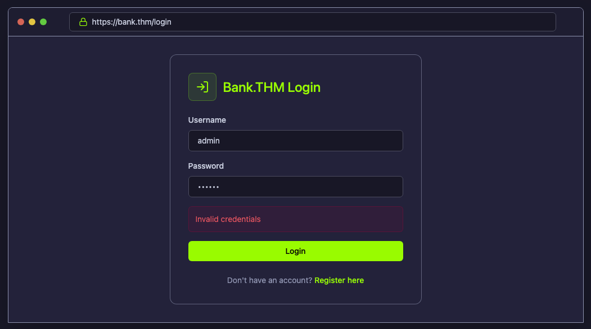
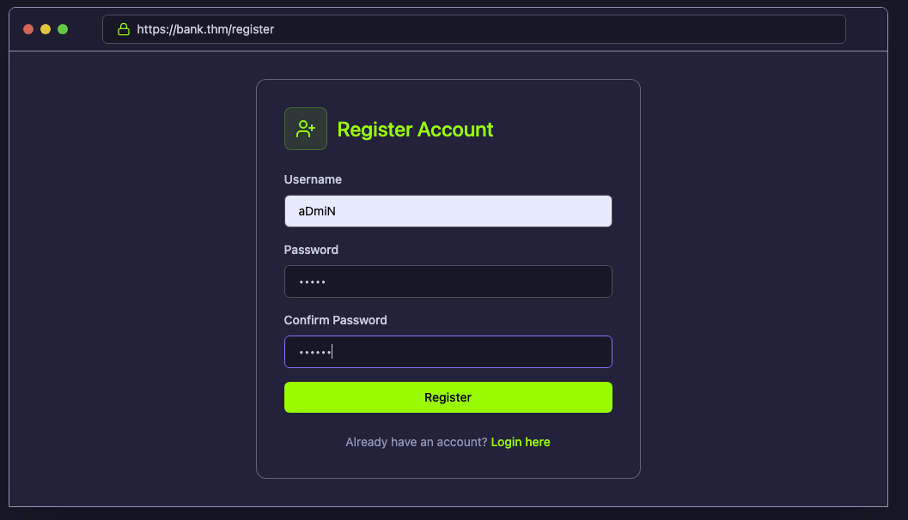
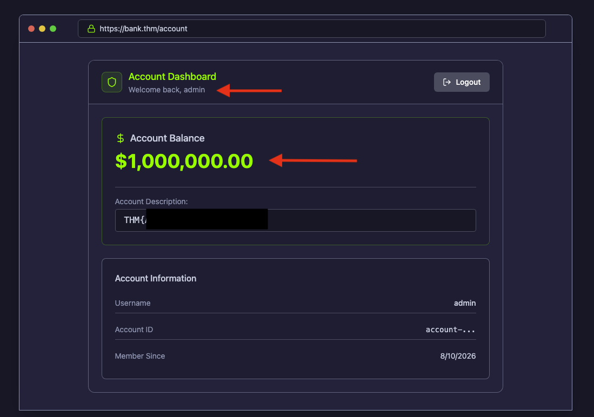

# Authentication Failures

Authentication failures happen when an application fails to properly verify or bind user identity, or fails to block bad actors from bypassing or fuzzing the authentication system (such as login and registration forms).

In this room, we have a mock ethernet banking system. Let's suppose that we are an ethical hacker working for a company hired to test THM Bank's security.

How do we find breaches in the system? Well, there is a variety of techniques we could try:

* Username enumeration
* Weak/guessable passwords (absence of lockout policies or rate limits)
* Logic flaws in the login/registration flow
* Insecure session or cookie handling

Suppose that through username enumeration, we discover that the user `ADMIN` exists (probably due to an error message exposing too much information). From there, we have a few routes to proceed.

Of course, we could sit here all night trying to manually type every possible password, or use tools like **John the Ripper** or **Hydra** to brute-force our entry into the system. But what if a rate limit or account lockout is implemented?

In this case, we can try to fuzz the username or exploit logic flaws in the registration process.

Trying to register another `admin` account directly probably won't work, but registering `aDmiN` might.

Then we tried to log in, and...

*Voilà!* Access granted to the `admin` account, completely exposing the system and violating the **Confidentiality** (C) of the CIA Triad.

---

### Why was `aDmiN` accepted and linked to the `admin` profile? (Theoretical Breakdown)

This behavior is caused by a **Username Collision / Normalization Logic Flaw**, usually resulting from an inconsistency between application code and database queries:

1. **Inconsistent Case Sensitivity (App vs. Database):**
   * **Registration Check:** When registering `aDmiN`, the backend application code checks if the username exists using a case-sensitive match (or strict string comparison in Python/Node.js). Since `"aDmiN" != "admin"`, the app concludes the username is available and approves registration.
   * **Database Query:** When storing or querying the database (e.g., MySQL/MariaDB with default `ci` / *case-insensitive* collations like `utf8_general_ci`), the database treats `aDmiN` and `admin` as identical. 

2. **Username Normalization / Lowercasing Bug:**
   * The application accepts `aDmiN` during validation, but normalizes it (converts to lowercase `admin`) before storing it or querying session cookies. As a result, the new session is bound directly to the existing primary key/account record for `admin`.
  
 This process shows how easy it can be to exploit logic flaws and weaknesses in a system.

There are many other things that could be done, such as **SQL Injection** and **NoSQL Injection**, but those are topics for another day.

