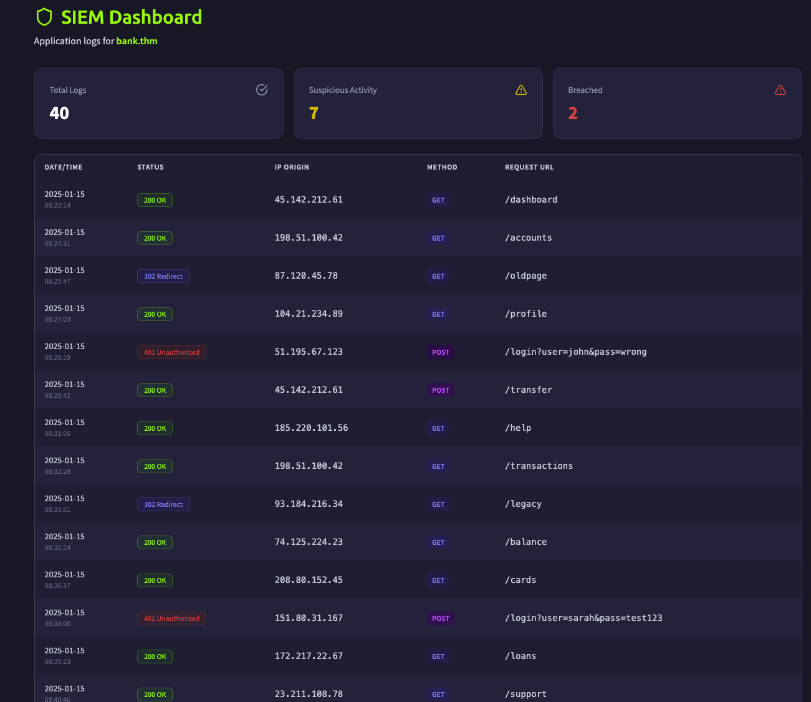
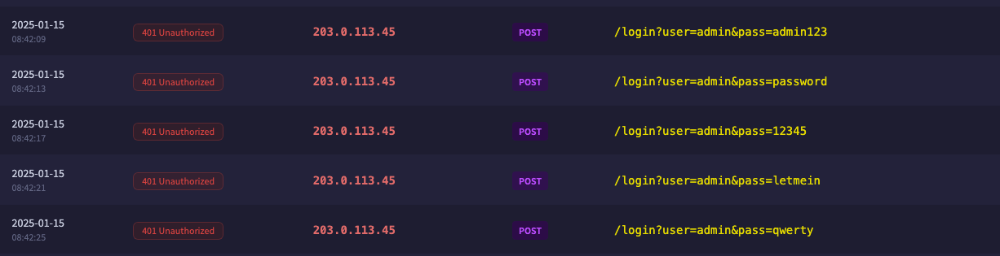
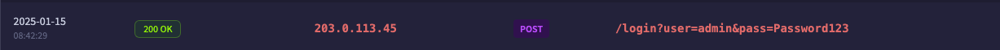
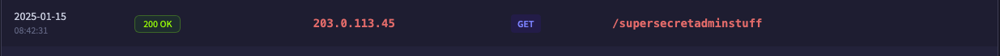
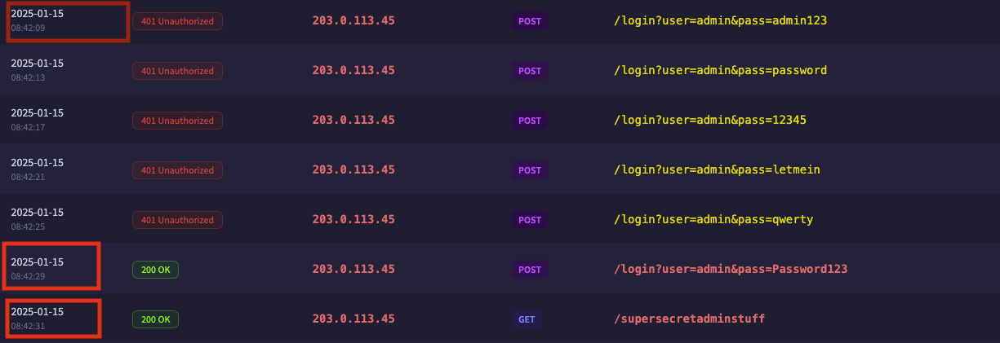
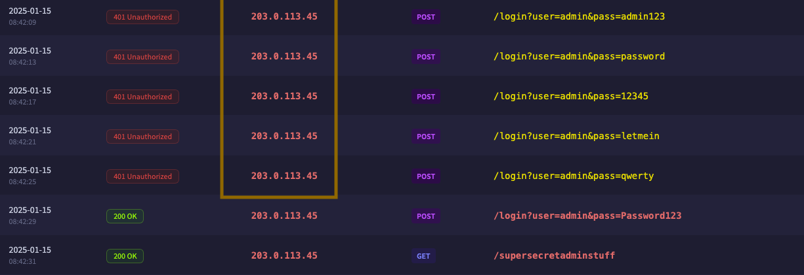
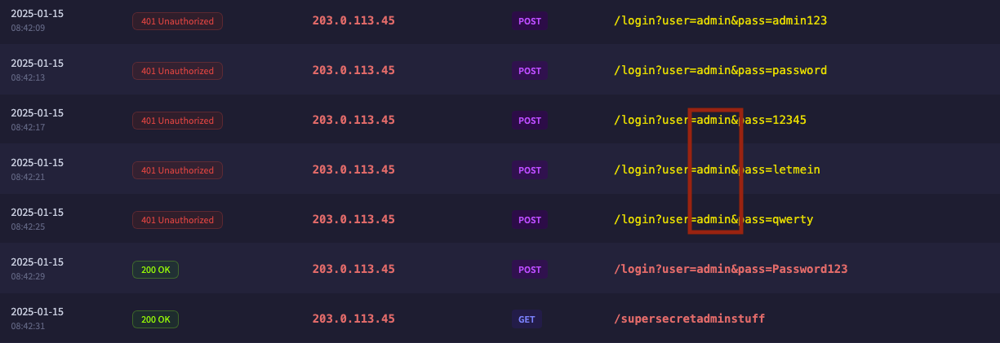
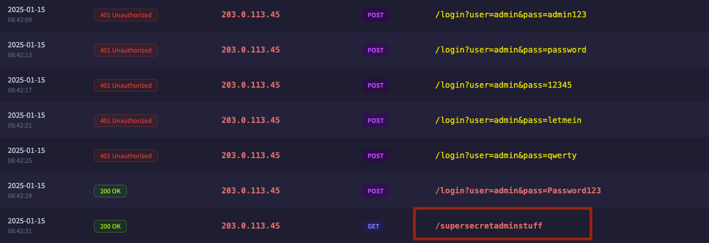

# Logging & Alerting Failures

What is the importance of logging and alerting? As a software engineer, I developed this notion a long time ago, because it is simple: **if you don't see what is going on, you don't know what is going on, and therefore it becomes very costly to understand and solve it.**

In Cyber Security, it is no different. You need logs and alerts to understand what is happening to the application—to know if anyone is trying to gain unauthorized access or, even worse, if they are already inside.

In this room, we started by looking into a SIEM dashboard.

Looking closer at the logs, we can see that the IP address `293.0.113.45` started to brute-force the `admin` password at `08:42:09`.

After multiple attempts, the account was breached at `08:42:29`, taking less than **30 seconds** to gain access to the system as admin.

With that access, the attacker navigated through the system to exfiltrate sensitive data.

Perhaps this data could be your company's next big product, your personal information, or your grandmother's retirement money.

One thing is evident: the system was breached and data was accessed.

Me and a friend have a saying about SIEM and log analysis, the **4 Ws**:
* **WHEN**
* **WHO**
* **WHERE**
* **WHAT**

Let me break it down for you guys:

### 1. WHEN = When did it happen?

In this case, we have three major "whens":
1. The moment the attack started.
2. The moment the `admin` account was breached.
3. The moment sensitive information was accessed.

### 2. WHO = Who is the attacker?

In this case, it is the origin IP address: `23.0.113.45`.

### 3. WHERE = Where did it happen?

In this case, it occurred on the `admin` account.

### 4. WHAT = What could the bad actor access or do?

In this case, access was gained to `super secret admin stuff`.

---

### How Could This Attack Have Been Prevented?

Looking back at this incident, proper security controls and hardening techniques could have prevented this unauthorized access before the breach occurred:

* **Rate Limiting & IP Blocking (Fail2ban / WAF):**
  Implementing an automatic block on an IP address after *X* failed attempts stops automated brute-force tools (like Hydra or Burp Intruder) in their tracks.
* **Generic Error Messages:**
  Hiding specific authentication errors (e.g., using *"Invalid credentials"* instead of *"User exists, but password incorrect"*) prevents attackers from enumerating valid usernames during initial reconnaissance.
* **Intrusion Prevention Systems (IPS) & SIEM Rule Triggers:**
  Configuring an IPS with active response rules allows the system to automatically detect high-frequency login attempts and block traffic at the network level, while triggering real-time alerts for the SOC team.
* **Password Policies & Credential Rotation:**
  Enforcing strong password pattern rules during creation (length, complexity, entropy) makes brute-forcing computationally infeasible. Additionally, enforcing periodic credential rotation for high-privilege accounts (like `admin`) limits the lifetime of compromised credentials.